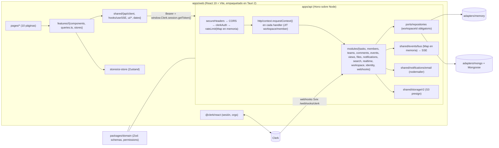

# Daybook — Auditoría de calidad (25-nov-2026)

Alcance: `apps/api` (Hono + Node), `apps/web` (React + Vite + Tauri), `packages/domain` (Zod).
Método: lectura del código con referencias de línea, `tsc`, ESLint, Vitest, `vite build`, `npm audit`, un smoke end-to-end de la API con dos organizaciones y tres roles (script externo al repo), `legacy-scan` y guías de la skill `modern-web-guidance`.
No se modificó código de la aplicación.

---

## 1. Resumen ejecutivo

- **El aislamiento entre organizaciones funciona.** Un usuario de otra org no pudo leer, editar, borrar, buscar, comentar ni ver actividad de la org sembrada (10/10 pruebas cruzadas devolvieron 404 o vacío). Los permisos de admin/member en miembros y teams también se respetan.
- **La autorización dentro de una misma organización tiene huecos reales.** Cualquier miembro puede editar o borrar comentarios ajenos y vistas guardadas ajenas. Un `PATCH` de comentario sin validar guardó `body: 42` y otro dejó el comentario sin cuerpo. El emoji `__proto__` en reacciones provoca un 500.
- **El módulo de archivos no es seguro tal como está.** El servidor confía en la `key`, el `fileId`, el tamaño y el MIME que envía el cliente. Se aceptó una `key` de otro workspace, un `taskId` de otra org, un `fileId` repetido, `text/html` y una subida de 8 MB sin límite. Además no hay UI que lo use.
- **Integridad de datos: 6 creaciones concurrentes produjeron 6 tareas con la misma clave `TSK-408`.** No hay contador atómico ni índice único.
- **Funcionalidad engañosa:** la página Notifications muestra la actividad del workspace, no las notificaciones del usuario. El filtro "Unread" no hace nada y el badge de no leídas está fijado a `false`.
- **Calidad general del código buena:** typecheck y lint de `apps/` y `packages/` limpios, tests en verde y módulos pequeños. Hay deuda clara: 13 hooks sin uso, alrededor de 100 clases CSS candidatas a código muerto, `requestContext` repetido 40 veces, branding mezclado (Gr8r / Alisuite / Daybook) y un bundle único de 750 kB.
- **Veredicto:** apto para seguir desarrollando **después de cerrar P0**. No apto para usuarios reales hasta cerrar P0 + P1.

---

## 2. Arquitectura real y diagrama de componentes

**Lo que está bien:** backend modular por dominio con puertos y adaptadores (hexagonal ligero), el `workspaceId` es obligatorio en todos los puertos y el dominio está compartido entre cliente y servidor.

**Desviaciones respecto a la screaming architecture de referencia** (`modules/<dominio>/{components, hooks, lib, services, states, utils}` + `modules/core`):

| Hoy | Referencia | Problema |
|---|---|---|
| `web/src/features/*` | `modules/*` | Nombre distinto; aceptable, pero la estructura interna no es uniforme |
| `features/tasks/task-ui-store.ts`, `use-task-*.ts` sueltos en la raíz | `tasks/states`, `tasks/hooks` | Mezcla de niveles |
| `features/auth`, `features/organizations` planos | `components/` | Inconsistente con `features/members/components` |
| `features/*/queries.ts` (fetch + hooks juntos) | `services/` + `hooks/` | Aceptable; decidir una sola convención |
| `web/src/stores/ui-store.ts` global | `modules/core/states` | Estado global fuera de un módulo |
| `web/src/shared/*` | `modules/core/*` | Equivalente; solo cambia el nombre |
| `web/src/styles/*.css` por capa (816 líneas en `overlays.css`) | estilos por módulo | Difícil saber qué CSS pertenece a qué |
| `api/modules/workspace/workspace-routes.ts:24-32` sirve `/members` y `/activity` | `members` y `activity` | Rutas fuera de su módulo |

---

## 3. Evaluación de calidad de código

| Área | Nota | Evidencia |
|---|---|---|
| Tipado | 9/10 | `tsc --noEmit` limpio en los 3 paquetes |
| Lint | 6/10 | `eslint apps packages` limpio, pero `npm run lint` (= `eslint .`) **falla con 90 errores** porque analiza `.claude/skills` y `.opencode/skills` |
| Tamaño y modularidad | 8/10 | Ningún archivo de API pasa de ~190 líneas (excepto el seed) |
| Código muerto | 4/10 | Ver lista abajo |
| Consistencia | 5/10 | Branding y estructura mezclados; ids en el argumento del hook en `useMarkNotificationRead(id)` (`features/notifications/queries.ts:12`) frente a la convención de ids en variables |
| Abstracciones | 6/10 | `requestContext()` repetido 40 veces y `requirePermission()` 18 veces dentro de los handlers; un handler que lo olvida queda sin contexto (`file-routes.ts:27`). `confirmUpload` recibe 10 parámetros posicionales y lo envuelve `confirmUploadInput` (`file-service.ts:94-150`) |
| Scripts del repo | 3/10 | `npm run dev` apunta a `@gr8r/legacy`, que no existe (`package.json` raíz) |

**Código muerto confirmado:**
- Web, hooks sin uso: `useEvents`, `useCreateEvent`, `useUpdateEvent`, `useDeleteEvent` (`features/events/queries.ts`); `useViews`, `useCreateView`, `useUpdateView`, `useDeleteView` (`features/views/queries.ts`); `useUpdateComment`, `useDeleteComment`, `useToggleReaction` (`features/comments/queries.ts`); `useNotifications`, `useMarkNotificationRead` (`features/notifications/queries.ts`).
- Web, otros: `PRIORITY_NAMES` (`shared/ui/vocab.tsx`) y las query keys `task`, `projects`, `project`, `member`, `files` y `activity` (`shared/api/client.ts:30-46`; `activity` está duplicada a mano en `features/activity/queries.ts:7`).
- API: `emailTemplate` (`shared/notifications/templates.ts`), `emailConfigured` (`email.ts:9`) y `headObject` (`r2.ts:46`).
- CSS: alrededor de 100 de 271 clases no aparecen en el TSX (algunas pueden ser dinámicas). Ejemplos claros: `.onb*`, `.fx-step`, `.ready-row` (`motion.css:200-225`), `.rte*`, `.fb-*`, `.inbox-*`, `.tmpls` y `.offline-bar`.
- Branding: `title` "Alisuite" (`index.html`), "Gr8r Studio" (`templates.ts:6`, seed), `service: 'gr8r-api'` (`app.ts:73`) y la key `gr8r-files/` (`file-service.ts:77`).

---

## 4. Hallazgos de seguridad

Severidad: **C** = crítico, **A** = alto, **M** = medio, **B** = bajo. "Verificado" = reproducido en el smoke.

| # | Sev | Hallazgo | Referencia | Estado |
|---|---|---|---|---|
| S1 | A | `POST /files` confía en `key`, `fileId`, `sizeBytes`, `mimeType` y `taskId` del cliente. Se aceptó la key `gr8r-files/w1/...` desde otra org; si R2 está configurado, `GET /:id/download` firma esa key, es decir, **lectura cruzada entre tenants** | `file-routes.ts:15-23,56-62`; `file-service.ts:113-150` | Verificado (201) |
| S2 | A | `POST /files/local-upload/:fileId` no resuelve workspace ni permisos, no tiene límite de tamaño y está montado siempre, también en producción con R2 | `file-routes.ts:25-33,46`; `file-service.ts:179` | Verificado (8 MB → 204) |
| S3 | A | Se aceptan `text/html` y `text/*`, que se sirven con el content-type del uploader | `file-service.ts:40-48`; `file-routes.ts:39` | Verificado |
| S4 | A | Cualquier miembro edita o borra comentarios ajenos (no se comprueba el autor) | `comment-routes.ts:24-36`; `comment-service.ts:74-83` | Verificado (200/204) |
| S5 | A | `PATCH /comments/:id` sin schema: `body` acepta `42`, `undefined` o cualquier tipo | `comment-routes.ts:28` | Verificado: guardó `42`; `{}` borró el body |
| S6 | M | Reacciones: emoji sin validar; `__proto__` → 500 y 10 000 caracteres se persisten | `comment-routes.ts:42`; `comment-service.ts:88-92` | Verificado |
| S7 | A | Vistas guardadas: un no propietario las modifica o elimina | `view-routes.ts:23-33`; `view-service.ts:20-29` | Verificado |
| S8 | M | HTML sin escapar en emails (título de tarea y cuerpo del comentario) | `task-service.ts:58`; `comment-service.ts:35` | Por código (requiere SMTP) |
| S9 | M | Sin límite de tamaño de body en `/api/*` (no hay `bodyLimit`) | `app.ts:76-81` | Verificado vía S2 |
| S10 | M | SSE: la membresía se valida solo al conectar; un miembro eliminado sigue recibiendo eventos del workspace hasta desconectarse | `stream-routes.ts:10-30` | Por código |
| S11 | M | Webhooks: no se maneja `organization.deleted` (datos huérfanos). Un `organizationMembership.updated` que llegue tarde después de `deleted` vuelve a crear al miembro | `clerk-routes.ts:32-47` | Por código |
| S12 | B | CORS con `credentials: true` aunque la API autentica con Bearer; abre la puerta a la autenticación por cookie sin necesidad | `app.ts:76` | Por código |
| S13 | B | Rate limiter: `Map` sin limpieza y por instancia | `app.ts:29-42` | Por código |
| S14 | B | `@hono/node-server` 1.19.19 con advisory moderado (GHSA-rmxm-3fg6-px4f, `serveStatic`); **no se usa `serveStatic`**, así que no es explotable hoy | `npm audit` | Verificado |
| S15 | B | CSP de Tauri: `connect-src` sin el dominio de R2 ni el de Clerk de producción; la web desplegada no tiene CSP | `tauri.conf.json` `app.security.csp` | Por código |

**Cookies y sesión (estado actual):**
- Clerk gestiona `__session` (JWT de vida corta) y `__client` (en el dominio de FAPI); la app no crea cookies propias.
- El cliente lee el token con `window.Clerk.session.getToken()` (`client.ts:10`) y lo envía como Bearer.
- **Recomendación:** API solo con Bearer (`credentials: false`), sin nuevas cookies propias, y usar `useAuth().getToken` en lugar del global `window.Clerk`.
- Si algún día hay cookie propia: `__Host-` + `Secure` + `HttpOnly` + `SameSite=Lax` (guía `security`).

---

## 5. Bugs y problemas funcionales

| # | Sev | Bug | Referencia |
|---|---|---|---|
| B1 | C | Claves de tarea duplicadas en creación concurrente (6/6 = `TSK-408`). Además `createTask` carga todas las tareas del workspace en cada creación | `task-service.ts:14-22,89`; `models/task.ts:34-36` (sin índice único) |
| B2 | A | Notifications muestra la **actividad** del workspace; "Mark all as read" marca notificaciones que nunca se muestran; el botón "Unread" no tiene handler | `pages/NotificationsPage.tsx:10,23-27` |
| B3 | A | Badge de no leídas fijado a `false` | `app/shell/Shell.tsx:30` (`unread={false}`) |
| B4 | A | Escape cierra todas las capas a la vez (Drawer + ConfirmDialog + Popover escuchan `keydown` global) | `Modal.tsx:15-22`; `Drawer.tsx:12-19`; `Popover.tsx:17-28` |
| B5 | A | El tema es por **membresía** (`member.preferences`), no por usuario: cambia al cambiar de organización. Además hay un destello en claro hasta que carga `/bootstrap` | `features/settings/theme.ts:10-21,34`; `index.html` sin `<meta name="color-scheme">` |
| B6 | A | El cliente no diferencia 401/403/404/422: `apiRequest` lanza `Error("API 403: …")`; el `QueryClient` reintenta 3 veces cualquier 4xx; un 403 `organizationRequired` (miembro eliminado) no lleva al selector de org | `client.ts:16-19`; `app/providers.tsx:5`; 0 usos de `isError` |
| B7 | M | `useSSE` reintenta cada 5 s para siempre, también ante 401/403; solo invalida `tasks` y `comments` (teams, members y events de otros usuarios no se reflejan) | `shared/hooks/useSSE.ts:6-11,30-35` |
| B8 | M | `TODAY` se calcula una vez al cargar el módulo; con la app de escritorio abierta pasada la medianoche, "hoy", "vencidas" y el calendario quedan desfasados | `shared/dates.ts:14` (usado en 7 archivos) |
| B9 | M | El "Skip to content" es un `<button>` sin acción | `app/shell/Shell.tsx:24-26` |
| B10 | M | Los toasts de error desaparecen a los 3,5 s, sin botón de cerrar; los timeouts no se limpian al desmontar | `shared/ui/Toast.tsx:24,33` |
| B11 | M | Un único `ErrorBoundary` global: un error en una página tumba todo el shell, sin opción de reintentar, y muestra `error.message` crudo (puede incluir el cuerpo de la API) | `shared/ui/ErrorBoundary.tsx:27`; `app/App.tsx` |
| B12 | M | `OptionMenu` usa `role="menu"`/`menuitemradio` sin navegación con flechas (no hay `onKeyDown`); `CommandPalette` usa `role="dialog"` + `aria-modal` en un `div`, sin trap ni inert | `shared/ui/OptionMenu.tsx:29-36`; `features/search/components/CommandPalette.tsx:72` |
| B13 | M | La notificación por email se envía con `await` dentro del request: un SMTP lento retrasa la respuesta. Si `notify` falla, la tarea ya se creó y el cliente recibe 500 | `notification-service.ts:21-26,45`; `task-service.ts:105` |
| B14 | B | `GET /events?from=zzz` responde 200 (query sin validar) | `event-routes.ts:14-16` |
| B15 | B | La API de dominio exige datos redundantes: el comentario pide `taskId` en el body además de en la URL; crear una vista exige `createdAt`/`updatedAt` del cliente | `domain/schemas/comment.ts:19-22`; `domain/schemas/filters.ts:47` |
| B16 | B | `presignUpload` tiene `http://localhost:3001` hardcodeado; `VITE_API_URL` cae en localhost si falta | `file-service.ts:79`; `client.ts:1` |

---

## 6. Persistencia e integridad de datos

| Tema | Estado | Riesgo |
|---|---|---|
| Aislamiento por tenant | Puertos con `workspaceId` obligatorio; verificado en memoria | Bajo |
| Upserts JIT de workspace y miembro | `$setOnInsert`/`$set`; índice único `(workspaceId, clerkUserId)` (`models/support.ts:28`) | Bajo |
| Ediciones parciales | Corregido con schemas de edición sin defaults | Bajo |
| Clave de tarea | Sin contador atómico ni índice único → duplicados (B1) | **Alto** |
| `purgeMember` | 3 pasos sin transacción (desasignar, quitar de teams, borrar); un fallo intermedio deja estado parcial; no emite eventos SSE | Medio (`member-service.ts:19-28`) |
| Borrado de organización | No se procesa `organization.deleted` → workspace, tareas y comentarios quedan para siempre | Medio |
| `user.deleted` | Solo marca `disabled`; `syncMember` reactiva cualquier `disabled` en el siguiente request (`identity-service.ts:20-33`), así que el estado `disabled` no tiene significado estable | Bajo |
| Referencias colgantes | Comentarios, notificaciones y vistas de un miembro purgado quedan con `authorId`/`ownerId` inexistente | Bajo (la UI debe tolerarlo) |
| Índices Mongo | `files` indexado por `projectId` pero consultado por `workspaceId` (`models/support.ts:102`); sin índice en views; `activity` y `notifications` crecen sin límite ni TTL | Medio |
| Volumen | `/bootstrap` y `/tasks` devuelven **todas** las tareas (doble descarga por mutación); `search` carga todas las tareas, miembros y teams en cada tecla (`search-service.ts:20-24`) | Medio a escala |
| Paridad de adaptadores | `fileId` repetido: la memoria sobrescribe y Mongo daría 500 por `_id` duplicado | Bajo |
| Lecturas Mongo | `.lean()` sin parsear con el schema de dominio → posible drift silencioso | Bajo |

---

## 7. Pruebas y validaciones ejecutadas

Entorno: copia aislada del repo (`npm ci` Linux arm64, Node 22.23).

| Validación | Resultado |
|---|---|
| `npm run typecheck` (api, web, domain) | ✅ 0 errores |
| `eslint apps packages` | ✅ 0 errores |
| `npm run lint` (`eslint .`) | ❌ 90 errores, todos en `.claude/skills` y `.opencode/skills` |
| Vitest | ✅ api 6 pasados / 1 omitido (integración Mongo); domain 14/14; web 1/1 |
| `vite build` | ✅ 1 chunk JS de **750 kB** (222 kB gzip) + CSS 82 kB; aviso de tamaño |
| `npm audit --omit=dev` | 1 moderado (`@hono/node-server`, no explotable hoy) |
| `legacy-scan apps/web/src` | 2 hallazgos: `motion.css:218` (`dynamic-sibling-animations`) y `view-model.ts:35` (`js/copying-array-methods`; se descarta mientras `lib` sea ES2022) |
| Smoke API con 2 orgs y 3 usuarios | 47 comprobaciones, resumidas abajo |

**Smoke, resumen:**
- ✅ Aislamiento: 10/10 (list, get, patch, bulk delete, member, search, comment, list comments, activity).
- ✅ Permisos: member no borra ni edita miembros ni crea teams (403); el admin no se borra a sí mismo (400).
- ✅ Validación: título de 10 000 caracteres → 422; asignar a un miembro de otra org → 422; bulk de 201 ids → 422; sin auth → 401; CORS de origen ajeno → sin `allow-origin`; webhook con firma inválida → 400; HSTS y nosniff presentes.
- ❌ Comentarios: edición y borrado ajenos (200/204), `body: 42` persistido, `{}` borró el body, `__proto__` → 500, emoji de 10 000 caracteres persistido.
- ❌ Vistas: edición y borrado por un no propietario.
- ❌ Archivos: key de otro workspace, `taskId` de otra org, `fileId` repetido, `text/html` y 8 MB sin auth de workspace, todos aceptados.
- ❌ Claves de tarea duplicadas en concurrencia.
- ⚠️ `events?from=zzz` → 200.

---

## 8. Riesgos no verificables

1. **UI en navegador y Tauri:** no ejecuté la interfaz. Los bugs de la UI salen de la lectura del código. Playwright está configurado (`playwright.config.ts`), pero no se ejecutó con Clerk real.
2. **Adaptador Mongo:** el test de integración está omitido y no hay Mongo en el entorno. No se verificaron índices reales, carreras de upsert ni el comportamiento de `$set` con `undefined`.
3. **Clerk en producción:** claims del token en la instancia de producción, orden y reintentos de webhooks (Svix no garantiza el orden) y cookies de Clerk dentro de WKWebView con origen `tauri://localhost`.
4. **R2:** presign, CORS del bucket y `connect-src` de la CSP no probados sin credenciales.
5. **SMTP:** no configurado (no aparece en `.env.example`).
6. **Escalado horizontal:** el bus de eventos y el rate limiter están en memoria; con más de una instancia, SSE y el límite de peticiones dejan de ser correctos.
7. **Soporte del WebView:** `<dialog closedby>`, `popover`, anchor positioning y `Temporal` dependen de la versión de WKWebView (macOS) y WebView2 (Windows); hay que verificarlo antes de adoptarlos o usar fallback.
8. **Scripts inline en Tauri:** el script anti-FOUC del tema necesita que Tauri añada el hash a la CSP en build; hay que verificarlo.

---

## 9. Oportunidades de abstracción y refactor (solo las que reducen riesgo o código)

1. **Middleware `scope` en `/api`.** Resuelve workspace y member una vez y los deja en `context.get('scope')`. Va acompañado de un `requirePermission(permission)` como middleware. Elimina 40 llamadas repetidas y hace imposible el caso de `local-upload`.
2. **Autorización por recurso en el servicio**, junto a la lógica y no en la ruta: `assertAuthor(comment, member)` y `assertOwner(view, member)`. Admin puede borrar.
3. **Un solo `ApiError` tipado en el cliente** (`status`, `message`, `issues`) y defaults del `QueryClient`: `retry` solo para 5xx/red, manejo global de 401/403.
4. **Una sola primitiva de overlay** basada en `<dialog>` nativo (Modal, Drawer, ConfirmDialog, CommandPalette) y `popover` para menús. Elimina 4 listeners globales de Escape.
5. **Fuente única de tareas:** quitar `tasks` de `/bootstrap`; Home ya usa `useTasks()` con fallback (`pages/HomePage.tsx:17-23`).
6. **Archivos:** desmontar el módulo hasta que exista la UI (menos es más) o rehacer el flujo con un registro pendiente del lado del servidor.
7. **Notificaciones:** envío desacoplado del request y escape HTML en un único sitio (o emails en texto plano).
8. **Estructura web uniforme** según la imagen: `modules/<dominio>/{components, hooks, services, states}` y `modules/core`, sin crear carpetas vacías.
9. **Code splitting por página** con `React.lazy` en `app/router.tsx`.

---

## 10. Plan priorizado

### P0 — antes del siguiente feature (seguridad e integridad)

> **Estado (25-nov-2026): completado.** Smoke de aceptación 28/28 en adaptador de memoria. Pendiente: verificar `nextKeyNumber` e índice único contra Mongo real. Hallazgo adicional corregido: `nonEmptyText.max(4_000)` limitaba los comentarios a 200 caracteres.

| Id | Cambio | Archivos |
|---|---|---|
| P0-1 | Archivos: **desmontar** `fileRoutes` hasta construir la UI de adjuntos. Si se mantiene: registro pendiente creado en `presign`; `confirm` solo por `fileId`; `key` derivada en el servidor; `headObject` para tamaño y MIME; `taskId` validado en el workspace; sin `text/html`; `local-upload` solo fuera de producción y con workspace | `app.ts:53`, `modules/files/*` |
| P0-2 | Comentarios: schemas `updateCommentInputSchema` y `reactionInputSchema` (emoji con allowlist o máximo 16 caracteres); solo el autor edita y el autor o un admin borra; reacciones sin prototipo | `comment-routes.ts`, `comment-service.ts`, `domain/schemas/comment.ts` |
| P0-3 | Vistas: solo el propietario edita o borra | `view-routes.ts`, `view-service.ts` |
| P0-4 | Clave de tarea: contador atómico por workspace (`$inc` en Mongo y contador en memoria) + índice único `(workspaceId, key)`; `createTask` deja de listar todas las tareas | `task-service.ts`, `ports/repositories.ts`, adapters |
| P0-5 | `bodyLimit` global en `/api` (1 MB) | `app.ts` |
| P0-6 | Escape HTML en emails (o texto plano) | `task-service.ts:58`, `comment-service.ts:35` |

### P1 — bugs funcionales y robustez

> **Estado (25-nov-2026): completado.** Smoke API 14/14 (SSE, webhooks, purga de org) y overlays verificados en Chrome headless (Escape por capas, foco, backdrop, toasts sobre modales). Pendiente fuera de alcance: el harness de Playwright (`test:visual`, `playwright.config.ts`) sigue apuntando a `@gr8r/legacy`.

| Id | Cambio |
|---|---|
| P1-1 | Notifications real: `useNotifications`, filtro Unread funcional, marcar una como leída y badge en el Topbar con el conteo real. O eliminar la página si no entra en el MVP |
| P1-2 | Overlays con `<dialog>` nativo + `popover`; `OptionMenu` con teclado (focusgroup/flechas) o sin `role="menu"` |
| P1-3 | `ApiError` + defaults del `QueryClient` + 401 → cerrar sesión, 403 `organizationRequired` → selector de org; `useSSE` con backoff y parada en 401/403 |
| P1-4 | Tema por usuario (Clerk `user.unsafeMetadata.theme`) + `localStorage` + `<meta name="color-scheme">` + script anti-FOUC |
| P1-5 | SSE: cerrar los streams del miembro purgado (evento `member.removed` en el bus) y `writeSSE` con manejo de errores |
| P1-6 | Webhooks: `organization.deleted` purga el workspace; `membership.updated` confirma con Clerk antes de recrear |
| P1-7 | Tooling: `npm run dev` correcto, ignorar `.claude`, `.opencode` y `.agents` en ESLint, actualizar `@hono/node-server` |
| P1-8 | `useToday()` que se recalcula a medianoche en lugar de `TODAY` constante |
| P1-9 | Skip link `<a href="#main-content">`; ErrorBoundary por ruta con "Reintentar" y mensaje genérico; toasts de error persistentes con botón de cerrar |

### P2 — arquitectura, abstracciones y rendimiento

> **Estado (25-nov-2026): completado.** `requestContext(` en módulos: 0. Bundle inicial 754 kB → 461 kB (140 kB gzip); el objetivo de 350 kB no se alcanza porque React DOM, React Router y Clerk ocupan la mayor parte. CSS 83 kB → 56 kB. Web reorganizada en `src/modules/<dominio>/{components, hooks, lib, services, states}` + `src/modules/core`.

| Id | Cambio |
|---|---|
| P2-1 | Middleware `scope` + `requirePermission` como middleware |
| P2-2 | Borrar código muerto (hooks, keys, `templates.ts`, `emailConfigured`, CSS muerto) y unificar el branding como Daybook |
| P2-3 | `/bootstrap` sin `tasks`; `search` con consulta en el repositorio y límite; paginación de notifications y activity |
| P2-4 | Notificaciones fuera del request; configuración SMTP en `config.ts` |
| P2-5 | Estructura `modules/<dominio>/{components, hooks, services, states}` + `modules/core`; mover `stores/ui-store` a core |
| P2-6 | `React.lazy` por página |
| P2-7 | Schemas de dominio sin datos redundantes (`taskId` en el comentario, timestamps en la vista) |
| P2-8 | Índices Mongo (files por workspace, views, TTL o tope en activity y notifications); `purgeMember` idempotente y ordenado |
| P2-9 | CORS `credentials: false`; usar `useAuth().getToken` en lugar de `window.Clerk` |

### P3 — mejoras menores

> **Estado (25-nov-2026): completado.** `toSorted` con `lib` ES2023; animaciones y keyframes sin uso eliminados (CSS 46 kB); guardia `isMutating` en mutaciones de tareas; Vite 8 + plugin-react 6, Vitest 5, ESLint 10 y Mongoose 9 (`returnDocument: 'after'`). Pendientes: CSP de la web desplegada (requiere los dominios de producción) y `Temporal`.

- `toSorted` (subir `lib` a ES2023) en `view-model.ts:35`.
- `motion.css` sin `nth-child` repetidos (o borrar `.onb*` si está muerto).
- Guardia `isMutating` para mutaciones optimistas concurrentes (`features/tasks/queries.ts:34`).
- Upgrades mayores aislados (Vite 8, Vitest 5, ESLint 10, Mongoose 9).
- CSP para la web desplegada y endurecimiento de Tauri en producción.
- `Temporal.PlainDate` cuando el WebView lo soporte.

---

## 11. Criterios de aceptación

| Id | Criterio verificable |
|---|---|
| P0-1 | Con el módulo montado: `confirm` con key ajena → 4xx; `taskId` de otra org → 404; `text/html` → 422; `local-upload` sin registro pendiente → 404; en `NODE_ENV=production` → 404. Desmontado: `/api/files/*` → 404 |
| P0-2 | Un member que edita o borra el comentario de otro → 403; el admin borra → 204; `body: 42` o `{}` → 422; emoji `__proto__` → 422 (nunca 500); el autor edita → 200 y aparece `editedAt` |
| P0-3 | Un no propietario hace PATCH o DELETE de una vista → 403 (o 404); el propietario → 200/204 |
| P0-4 | 50 `POST /tasks` concurrentes → 50 claves únicas y consecutivas; Mongo rechaza un duplicado por índice |
| P0-5 | Body de 2 MB en cualquier `/api/*` → 413 |
| P0-6 | Título `` → el HTML del email contiene `&lt;img` |
| P1-1 | La página lista solo `/api/notifications` del usuario; Unread filtra; el badge muestra el conteo y baja al marcar |
| P1-2 | Con un ConfirmDialog sobre un Drawer, Escape cierra solo el ConfirmDialog; el foco vuelve al disparador; Tab no sale del modal; en la DOM no hay `role="dialog"` manual |
| P1-3 | Un 403 `organizationRequired` lleva al selector o creación de org sin reintentos; un 404 no se reintenta; un 500 se reintenta como máximo 2 veces; el SSE deja de reconectar tras un 401 |
| P1-4 | Cambiar de org no cambia el tema; recargar en oscuro no muestra destello claro; los scrollbars y controles nativos siguen el tema |
| P1-5 | Al eliminar a un miembro, su stream SSE se cierra en menos de 1 s |
| P1-6 | El webhook `organization.deleted` elimina el workspace y sus datos; un `membership.updated` repetido después de `deleted` no recrea al miembro |
| P1-7 | `npm run dev`, `npm run lint` y `npm audit --omit=dev` en verde |
| P1-8 | Con el reloj simulado pasando la medianoche, "Today" y "Overdue" se actualizan sin recargar |
| P1-9 | Tab desde el inicio enfoca "Skip to content" y Enter mueve el foco a `#main-content`; un error en una página deja el sidebar operativo; un toast de error permanece hasta cerrarlo |
| P2-1 | 0 llamadas a `requestContext(` en `modules/`; todos los tests y el smoke en verde |
| P2-2 | Script de exports sin uso → 0 resultados; `grep -ri "gr8r\|alisuite"` solo en nombres de paquete (o 0 si se renombran) |
| P2-3 | Una mutación de tarea provoca 1 descarga de la lista, no 2; `/search` responde con consulta en el repositorio y límite |
| P2-5 | Todos los módulos siguen la misma plantilla; `tsc`, lint y build en verde; sin carpetas vacías |
| P2-6 | Chunk inicial < 350 kB minificado |
| P2-8 | `explain()` de las consultas principales usa índices (IXSCAN) |

---

## 12. Evaluación final de preparación

| Dimensión | Nota |
|---|---|
| Arquitectura | 7/10 |
| Aislamiento multi-tenant | 9/10 |
| Autorización intra-tenant | 4/10 |
| Integridad de datos | 5/10 |
| Calidad de código | 7/10 |
| Accesibilidad y UX de overlays | 5/10 |
| Operabilidad (scripts, lint, observabilidad) | 4/10 |

**Para continuar desarrollando:** sí, después de cerrar P0 (estimación: 1 sesión).
**Para usuarios reales:** no, hasta cerrar P0 + P1 y verificar los riesgos 1–3 de la sección 8.
**Para escalar a más de una instancia:** requiere sacar de memoria el bus SSE y el rate limiter.

---

### Modern Web Guidance

Guías consultadas con `npx modern-web-guidance@latest`, versión `2026_11_16-268fb9ea`:

- `dialog`: "Use the native `<dialog>` element"; "DON'T add `role="dialog"`, `aria-modal`, a focus trap" → B4, B12, P1-2.
- `menu`: "Do not add `role="menu"` or `role="menuitem"` in the shared markup" (se usa focusgroup) → B12.
- `viewport-aware-dropdowns`: no aplicar `role="menu"` "unless you fully implement" el patrón → `OptionMenu`.
- `persistent-toast-notifications`: "Use popover="manual""; "provide an explicit "Close" button" → B10.
- `dark-mode`: aplicar `color-scheme` en `:root` y `<meta name="color-scheme" content="light dark">` → B5.
- `dark-mode-toggle`: "Persist the override in `localStorage`" y script inline "NOT `type=module`" contra el FOUC → P1-4.
- `security`: "Prefer `textContent`… over `innerHTML`"; cookies con prefijo `__Host-`, `HttpOnly`, `SameSite=Lax` → S8, sección de cookies.
- `accessibility`: landmarks, skip links y HTML nativo antes que ARIA → B9, B12.
- `capture-location-agnostic-data`: `Temporal.PlainDate` para fechas sin zona → B8, P3.
- `js/copying-array-methods` y `dynamic-sibling-animations` (legacy-scan) → P3.
